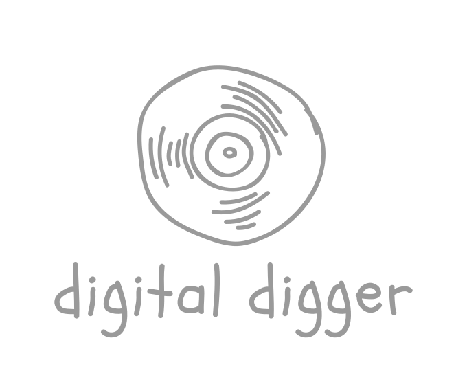
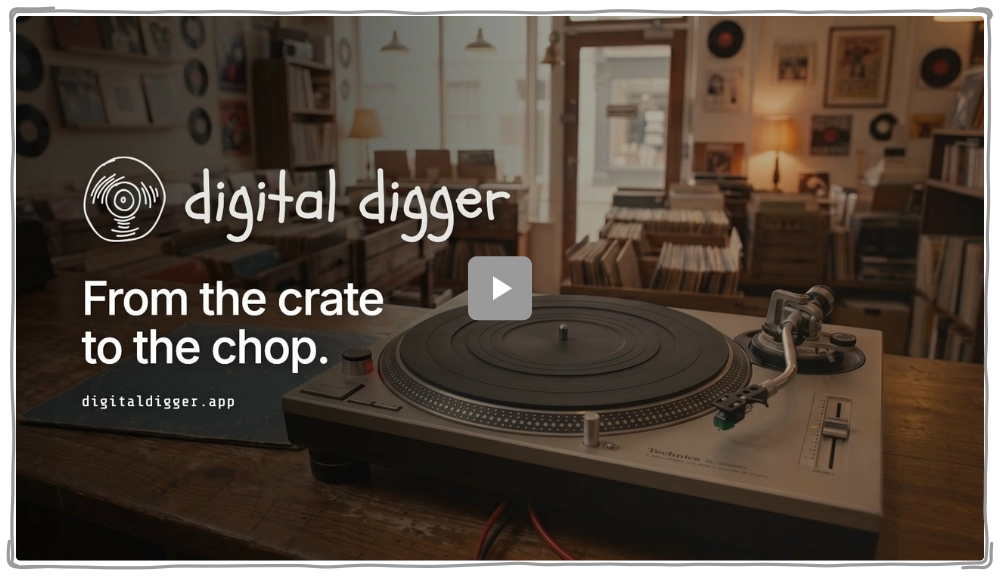

  

 

  <a href="https://digitaldigger.app"><samp>Visit digitaldigger.app</samp></a>

 

  <samp>Digital Digger is a desktop workspace for music producers, beatmakers and sound designers who want to turn their audio collection into a library they can actually use.</samp>

  <samp>It brings sample discovery, organisation, editing and stem separation together, so you can spend less time searching and more time making music.</samp>

 

  

  <samp>THE WALKTHROUGH</samp>

## <samp>See Digital Digger in action.</samp>

  <samp>Collect, edit, and separate samples. Watch how it all comes together in Digital Digger.</samp>

  <a href="https://www.youtube.com/watch?v=ZgcCvcHajr4"><samp>Watch on YouTube ↗</samp></a>

  

